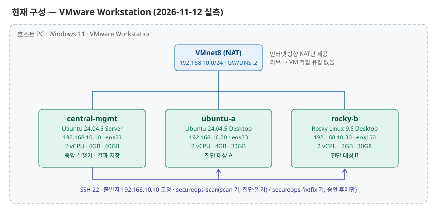
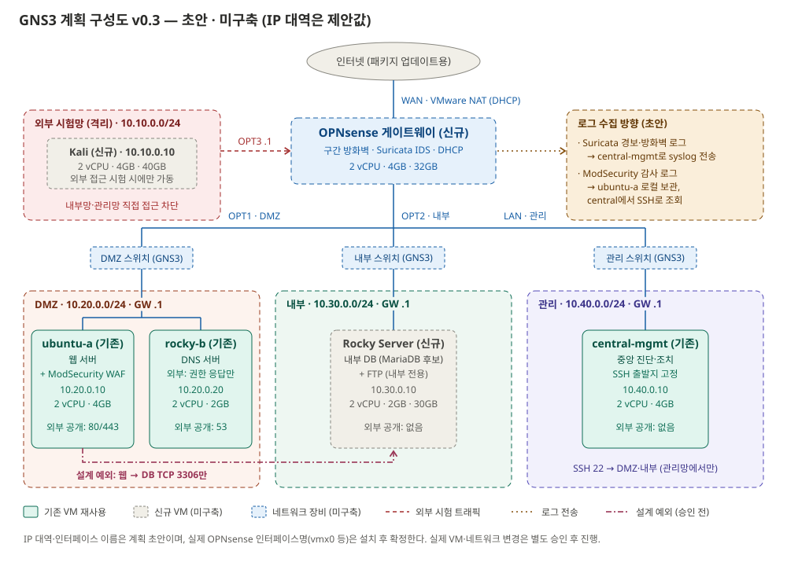

# SecureOps 인프라 구성도 및 GNS3 망 분리 계획안 (v0.2)

**작성:** 김민우 (A · 서버·네트워크 인프라) · 2026-11-12 작성, 11/13 제출용  
**상태:** 2026-11-12 팀장 검토에서 **6대 구성 방향을 계획안으로 채택**했다. 실제 VM·네트워크 변경(설치·서비스 변경·IP 변경)은 **별도 승인 후** 진행한다.  
**원칙:**
- 11/16 SSH-01 실서버 검증과 11/18 중간발표까지는 현재 VMware VMnet8 환경을 그대로 유지한다.
- GNS3 환경은 중간발표 이후 단계적으로 구축하고, 12/02 최종발표에 맞춰 기본 기능부터 우선한다.
- GNS3·OPNsense·IDS·WAF·DNS/FTP는 아직 구축하지 않았다. 실제 연동·접근통제 증거가 생기기 전까지 완료로 쓰지 않는다(`docs/integration-checklist.md` G-12, G-19).

## 1. 현재 구성 (VMware, 실측)

| 구분 | 현재 상태 | 근거 |
| --- | --- | --- |
| 네트워크 | VMnet8 NAT 단일 대역 `192.168.10.0/24`, 고정 IP, 외부에서 VM으로 직접 들어오는 경로 없음 | README 2·3장 |
| 인증 | 계정별 Ed25519 키 분리(scan / fix), 비밀번호 없는 전용 계정, 출발지 `192.168.10.10` 확인 | HANDOFF 2-4 |
| 권한 | sudoers 초안 v0 — 명령·인자 고정. scan은 읽기 보조만, fix는 승인 파일 설치·reload만 | README 5-6 |
| SSH-01 흐름 (11/16 목표) | 중앙 실행기 → `ssh ubuntu-a`/`rocky-b` → `sudo -n` 수집기 → JSON → D v1.2 저장·재조회. SSH 계층 사전 점검은 통과, 수집기는 설치 승인 대기 | HANDOFF 2-5 |
| 복구 | 스냅샷 `00` → `01` (`ubuntu-a`는 `01-ssh-security-configured-passwd`가 일반 복구 기준), VM 폴더 ZIP 백업·SHA-256·복원 시험 | README 7장 |

## 2. GNS3 계획 구성도 (초안)

| 서버 | 구간 | 역할 | 구분 | 사양 |
| --- | --- | --- | --- | --- |
| OPNsense | 경계 | 구간 방화벽, Suricata IDS, DHCP | 신규 | 2 vCPU · 4GB · 32GB |
| `ubuntu-a` | DMZ | 웹 서버 + ModSecurity WAF | 기존 재사용 | 2 vCPU · 4GB · 30GB |
| `rocky-b` | DMZ | DNS 서버 | 기존 재사용 | 2 vCPU · 2GB · 30GB |
| Rocky Server | 내부 | 내부 서비스 + FTP | 신규 | 2 vCPU · 2GB · 30GB |
| `central-mgmt` | 관리 | 중앙 진단·조치 서버 (SSH 유일 출발지) | 기존 재사용 | 2 vCPU · 4GB · 40GB |
| Kali | 외부 시험 | 승인된 격리 실습망에서 외부 접근 시험 | 신규 (시험 시에만 가동) | 2 vCPU · 4GB · 40GB |

## 3. 구간별 IP 대역·인터페이스 (초안)

현재 대역(`192.168.10.0/24`)과 겹치지 않게 잡았다. OPNsense의 실제 인터페이스 이름(`vmx0` 등)은 설치 후 확정한다.

| 구간 | 대역 (제안) | OPNsense 인터페이스 | 게이트웨이 | 호스트 (제안) |
| --- | --- | --- | --- | --- |
| WAN | VMware NAT (DHCP) | WAN | VMware NAT | OPNsense WAN 주소만 |
| 관리 | `10.40.0.0/24` | LAN (관리 GUI 허용 구간) | `10.40.0.1` | `central-mgmt` `.10` |
| DMZ | `10.20.0.0/24` | OPT1 | `10.20.0.1` | `ubuntu-a` `.10`, `rocky-b` `.20` |
| 내부 | `10.30.0.0/24` | OPT2 | `10.30.0.1` | Rocky Server `.10` |
| 외부 시험 | `10.10.0.0/24` | OPT3 | `10.10.0.1` | Kali `.10` |

- 각 구간은 GNS3 내장 스위치로 묶는다(추가 VM 없음).
- 고정 IP는 서버만 쓴다. DHCP는 외부 시험망(Kali)에서만 쓸지 검토한다.

## 4. 구간별 통신 허용 정책 (초안)

기본 정책은 **모두 차단**이다. 아래에 적은 통신만 허용한다.

| # | 출발 → 도착 | 허용 | 비고 |
| --- | --- | --- | --- |
| 1 | 관리 → DMZ·내부 | TCP 22 (`central-mgmt`에서만) | 진단(scan)·조치(fix) SSH 경로 보존 |
| 2 | 관리 → OPNsense | HTTPS(GUI), SSH | 관리 GUI는 관리망에서만 접근 |
| 3 | 외부 시험 → DMZ 웹 | TCP 80/443 | ModSecurity 경유 |
| 4 | 외부 시험 → DMZ DNS | UDP/TCP 53 | **권한 응답만**, 재귀 질의 거부 |
| 5 | 외부 시험 → 내부·관리·OPNsense | **차단** | 외부 시험망에서 관리망 직접 접근 금지 |
| 6 | 내부 → DMZ DNS | UDP/TCP 53 | 내부·관리·DMZ 서버에는 재귀 질의 허용 |
| 7 | 내부·관리 → 내부 FTP | FTP (포트 범위 설치 시 확정) | **FTP는 외부 노출 없음** |
| 8 | DMZ → 내부 | **차단** (예외 필요 시 별도 승인) | DMZ가 뚫려도 내부로 확산 방지 |
| 9 | DMZ·내부 → 관리 | **차단** | 관리망은 들어오는 통신을 받지 않음 |
| 10 | OPNsense → `central-mgmt` | syslog (UDP/TCP 514 중 택1) | 로그 전송, 5장 참고 |
| 11 | DMZ·내부·관리 → WAN | HTTP/HTTPS (패키지 업데이트) | 필요 시에만, NAT 경유 |

- **DNS 재귀 질의:** 외부 시험망에는 권한 응답만 주고, 내부·관리·DMZ에만 재귀를 허용한다(`rocky-b` 설정과 OPNsense 규칙 두 곳에서 제한).
- **FTP:** 내부 전용이다. 외부 시험망과 DMZ에서는 접근할 수 없다.

## 5. IDS·WAF 위치와 로그 수집 방향

| 구성 | 위치 | 운영 방식 (초안) | 로그 |
| --- | --- | --- | --- |
| Suricata IDS | OPNsense | 탐지 전용(IDS)으로 시작하고, 차단(IPS)은 오탐 확인 후 검토. 감시 인터페이스는 OPT3(외부 시험)과 OPT1(DMZ)부터 | 경보·방화벽 로그 → `central-mgmt`로 syslog 전송 |
| ModSecurity WAF | `ubuntu-a` 웹 서버 모듈 | 공개 규칙 세트로 탐지 모드부터 시작, 차단 모드는 시험 후 전환 | 감사 로그는 `ubuntu-a` 로컬에 보관하고, `central-mgmt`에서 SSH로 조회 |

- **장비 성능:** OPNsense에 Suricata를 켜면 규칙 수에 비례해 메모리를 쓴다. 4GB로 시작하고 규칙 세트는 최소 범주부터 켠다. 2 vCPU에서 처리량이 부족하면 감시 인터페이스를 줄인다.
- **로그 수집:** 관리망으로 들어오는 통신은 OPNsense syslog(4장 #10)만 연다. 서버 로그는 지금처럼 `central-mgmt`가 SSH로 가져온다. 관리망 차단 원칙(4장 #9)을 지키기 위해서다.
- 수집 위치·보관 기간·형식은 D(결과 저장)와 LOG-01(C)에 맞춰 구축 시 확정한다.

## 6. 서버별 서비스와 진단 모듈 연결

| 서버 | 서비스 (예정) | 연결 진단 모듈 | 비고 |
| --- | --- | --- | --- |
| `ubuntu-a` | 웹(Apache 또는 Nginx 중 선택) + ModSecurity, SSH | SSH-01·SSH-02·ACC-01·ACC-02(B), FILE-01·SVC-01·FW-01·LOG-01(C) | 웹 서비스가 추가되면 SVC-01·FW-01 결과가 바뀌므로 `02-vuln-baseline`과 함께 정리 |
| `rocky-b` | DNS(BIND 등), SSH | 같음 | 재귀 질의 설정이 SVC-01 판단 근거 |
| Rocky Server (내부) | 내부 서비스 + FTP(vsftpd 등), SSH | 같음 | 새 진단 대상이므로 `targets.json`·전용 계정·sudoers v0 적용이 필요(승인 후) |
| `central-mgmt` | 중앙 실행기, 결과 저장(D), 승인·조치(E) | 진단 주체 (대상 아님) | SSH 유일 출발지 |
| OPNsense | 방화벽, IDS | 진단 대상 아님 | 정책·경보는 화면·로그 증거로 관리 |
| Kali | 외부 접근 시험 | 진단 대상 아님 | 시험 시에만 가동 |

- `ubuntu-a`·`rocky-b`는 Desktop 에디션이라 cups·avahi 같은 기본 서비스가 DMZ에 노출된다. 의도된 진단 대상인지 B·C와 함께 정리한다.
- 망 구간 정보는 운영 조치 우선순위에만 쓰고 CVSS Base Score에는 더하거나 빼지 않는다(`docs/security-policy/cvss-scoring-policy-v1.2.md`).

## 7. 자원 계획 (GNS3 VM 포함)

| 항목 | vCPU | RAM | 디스크 (최대 할당) |
| --- | --- | --- | --- |
| OPNsense | 2 | 4GB | 32GB (신규) |
| `ubuntu-a` | 2 | 4GB | 기존 |
| `rocky-b` | 2 | 2GB | 기존 |
| Rocky Server | 2 | 2GB | 30GB (신규) |
| `central-mgmt` | 2 | 4GB | 기존 |
| Kali | 2 | 4GB | 40GB (신규) |
| GNS3 VM (필요 시) | 2 | 4GB | 약 20GB (신규) |
| **합계** | **14** | **24GB** (Kali를 끄면 20GB) | **신규 약 122GB** |

- 호스트: RAM 31.9GB, i7-12700KF (12코어/20스레드). 24GB를 쓰면 Windows 몫으로 약 8GB가 남는다.
- GNS3 VM은 VMware VM을 노드로 연결하는 방식이면 필요 없을 수도 있다. 설치 시 확인하고, 일단 예산에는 넣었다.
- 디스크: C 여유 약 130GB, E 여유 약 1.4TB. 신규 VM과 이행 전 백업 ZIP은 **E 드라이브**에 둔다.
- 현재 VMware 환경과 GNS3 환경은 **동시에 켜지 않는다.** 같은 VM을 쓰고 IP도 다르기 때문이다.

## 8. 기본 프로젝트와 심화 프로젝트 범위

| 범위 | 기본 프로젝트 (현재 VMware, 11/18까지) | 심화 프로젝트 (GNS3, 11/18 이후 ~ 12/02) |
| --- | --- | --- |
| 네트워크 | NAT 단일 대역 | 외부 시험·DMZ·내부·관리 구간 분리 |
| 접근통제 | 호스트 방화벽 진단(FW-01), SSH 키·계정·sudo 최소 권한 | OPNsense 구간 정책과 실제 접근 시험 |
| 탐지·방어 | 인증 로그 진단(LOG-01) | Suricata 경보, ModSecurity 탐지·차단 로그 |
| 서비스 | 진단 대상 2대 | DMZ 웹·DNS, 내부 서비스·FTP |
| 진단·조치 | 중앙 SSH-01 진단 → JSON v1.2 저장·재조회, 승인 기반 조치 | 신규 내부 서버까지 대상 확대, 구간 정보를 조치 우선순위에 반영 |

**심화 단계 구축 순서 (제안)**
1. OPNsense와 구간 분리, `central-mgmt` → DMZ SSH 재검증
2. `ubuntu-a` 웹 + ModSecurity, `rocky-b` DNS (재귀 제한)
3. 내부 Rocky Server + FTP, 진단 대상 등록
4. Suricata와 로그 수집
5. Kali 외부 접근 시험과 차단 증거

## 9. 전환 절차 (스냅샷·복구·SSH 재검증)

모든 단계는 별도 승인 후에 진행한다.

1. **기준점 확보:** VM 3대를 종료하고 이행 전 스냅샷을 만든다(이름은 승인 시 확정). VM 폴더 ZIP 백업, SHA-256, `7z t`, 복원 시험을 7-3과 같은 절차로 한다.
2. **네트워크 변경:** VM NIC를 GNS3 구간에 연결하고, 고정 IP를 3장 값으로 바꾼다(Ubuntu netplan, Rocky nmcli).
3. **중앙 설정 갱신:** `central-mgmt` `~/.ssh/config`의 `HostName`, `known_hosts`(호스트 키는 그대로이므로 지문 확인 후 새 IP 등록), `targets.json`, `ssh01_context`(새 `central-mgmt` IP)를 바꾼다. 수집기 `ROOT_CONTEXT`도 같은 값으로 맞춘다.
4. **재검증:** HANDOFF 2-4(출발지·키 지문), 2-5(`UseDNS`·`Match`·`sshd -T -C`), 실행기 SSH 계층 사전 점검, sudoers v0 `sudo -l`을 다시 확인한다. 구간 정책은 허용·차단을 실제 접속으로 시험한다.
5. **복구:** 문제가 생기면 1단계 스냅샷으로 Go To 한다. 그래도 안 되면 ZIP 백업으로 복원한다. 현재 VMware 환경으로 돌아갈 때도 같은 방법을 쓴다.
6. sudoers·계정·키는 이행 중에 바꾸지 않는다. IP와 SSH 설정만 바뀐다.

## 10. 확인 필요 사항

| 항목 | 내용 |
| --- | --- |
| IP 대역 | 3장 값은 제안이다. 팀 확정이 필요하다. |
| 웹·DNS·FTP 소프트웨어 | Apache/Nginx, BIND 등은 후보다. B·C 진단 범위와 맞춰 확정한다. |
| GNS3 VM 필요 여부 | 설치 시 확인 |
| 신규 내부 서버 | 진단 대상 등록 절차(계정·키·sudoers v0 적용)는 별도 승인 |
| Kali 시험 범위 | 승인된 격리 실습망 안에서만 시험하며, 시험 시나리오는 별도로 정한다 |
